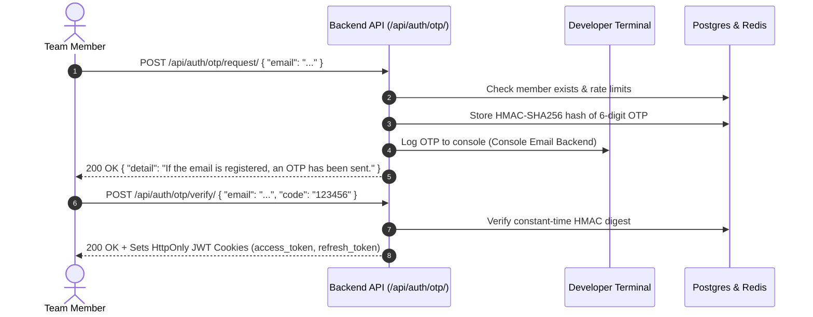

# ENP Racing Team ERP — Backend

Comprehensive Enterprise Resource Planning (ERP) platform and REST API built with **Django REST Framework**, **PostgreSQL (pgvector)**, and **Redis** for the **ENP Racing Team** (Formula Student team at École Nationale Polytechnique, Algiers).

---

## 📌 Important Data Seeding Notice

> [!IMPORTANT]
> **What data is seeded:**
> The database seeder (`seed_all`) populates **ONLY** the organization structure and core people data:
> - **Organizational Units** (`OrgUnit`): Root club, Executive Bureau, Technical Department, FS Subteams, Poles, etc.
> - **Roles** (`Role`): Standardized club and Formula Student roles with scopes and hierarchy.
> - **Members** (`Member`): All active and alumni team members (with university emails, phone numbers, and profile links).
> - **Memberships** (`Membership`): Official team assignments, executive bureau memberships, and primary affiliations.
>
> **What is NOT seeded:**
> All other ERP modules (**Inventory**, **Finance**, **Purchasing**, **Tasks**, **Equipment**, **Documents**, **Telemetry**, **Subsystems**) have their database schemas and Django Admin panels configured, but **contain NO seeded data** (they will appear empty in the admin panel until you add records).

---

## 🛠️ Tech Stack & Requirements

- **Language & Framework:** Python 3.12+, Django 6.1, Django REST Framework 3.18
- **Database:** PostgreSQL 16 (pgvector enabled) via Docker
- **Caching & Rate Limiting:** Redis 7 via Docker
- **Authentication:** Invite-Only Passwordless OTP (HMAC-SHA256, Redis cooldown & attempt limits, HTTP-only Cookie JWTs)
- **Email:** Django Console Backend (OTPs output directly to your terminal during development)
- **Containerization:** Docker & Docker Compose

---

## 🚀 Step-by-Step Setup Guide (First-Time User)

Follow these exact steps from scratch to get the project running and access the Django Admin Panel.

### Step 1: Clone the Repository

```bash
git clone <repository-url>
cd enpracingteam
```

---

### Step 2: Configure Environment Variables

The project uses two environment files:
1. **Root `.env`**: Configures Docker services (PostgreSQL).
2. **Backend `.env`**: Configures Django settings and database connections.

#### On Windows (PowerShell):
```powershell
Copy-Item .env.example .env
Copy-Item backend\.env.example backend\.env
```

#### On Linux / macOS (Bash):
```bash
cp .env.example .env
cp backend/.env.example backend/.env
```

> [!TIP]
> The default credentials in `.env.example` and `backend/.env.example` already match out of the box (`POSTGRES_DB=enp_racing_team_erp`, `POSTGRES_USER=enp`, `POSTGRES_PASSWORD=changeme`). If you change the password in `.env`, ensure you update `DB_PASSWORD` in `backend/.env` with the same value.

---

### Step 3: Start PostgreSQL & Redis (Docker)

Make sure **Docker Desktop** is running, then run:

```bash
docker compose up -d
```

Verify that both containers (`enp_racing_team_db` and `enp_redis`) are healthy and running:

```bash
docker compose ps
```

---

### Step 4: Set Up Python Virtual Environment & Install Dependencies

Navigate into the `backend/` directory:

```bash
cd backend
```

#### On Windows (PowerShell):
```powershell
# 1. Create virtual environment
python -m venv .venv

# 2. Allow script execution in current PowerShell session (if restricted)
Set-ExecutionPolicy -ExecutionPolicy RemoteSigned -Scope Process

# 3. Activate the virtual environment
.\.venv\Scripts\Activate.ps1

# 4. Install dependencies
python -m pip install --upgrade pip
pip install -r requirements.txt
```

#### On Linux / macOS (Bash):
```bash
# 1. Create virtual environment
python3 -m venv .venv

# 2. Activate the virtual environment
source .venv/bin/activate

# 3. Install dependencies
pip install --upgrade pip
pip install -r requirements.txt
```

---

### Step 5: Run Database Migrations

Apply the database schema to the PostgreSQL database:

```bash
python manage.py migrate
```

---

### Step 6: Seed Initial Data (Members, Roles, Org Units)

Run the master seeding command:

```bash
python manage.py seed_all
```

**What this command does:**
1. Runs `seed_org_units`: Creates the organizational hierarchy.
2. Runs `seed_roles`: Creates all predefined organizational and technical roles.
3. Runs `seed_members`: Creates team members with unusable passwords (invite-only) and sets their primary memberships.
4. Runs `sync_group`: Ensures all department heads are synced to the Executive Bureau.
5. Runs verification checks to confirm data integrity.

> **Reminder:** Only Members, Roles, OrgUnits, and Memberships are populated. Modules like Inventory, Tasks, and Finance remain clean and empty.

---

### Step 7: Create an Admin Account to Access the Admin Panel

Because members are pre-created with unusable passwords (invite-only passwordless system), you need to assign admin privileges and a password to log into the Django Admin web interface.

You have two options:

#### Option A (Recommended): Promote an Existing Seeded Member
Use the built-in `dev_login` command to assign a password and superuser rights to one of the seeded members:

```bash
python manage.py dev_login youcef.bengoumida@g.enp.edu.dz --password admin123 --admin
```
*(You can replace the email with any seeded member's email, e.g., `mohamed_ilyes.menzer@g.enp.edu.dz`).*

#### Option B: Create a Brand New Superuser
Alternatively, create a standalone superuser:

```bash
python manage.py createsuperuser
```
Follow the prompts to enter an email and password.

---

### Step 8: Start the Development Server

Start the Django development server:

```bash
python manage.py runserver
```

You will see output similar to:
```text
Django version 6.1.1, using settings 'config.settings'
Starting development server at http://127.0.0.1:8000/
Quit the server with CTRL-BREAK.
```

---

### Step 9: Explore the Django Admin Panel

1. Open your browser and navigate to:
   ```text
   http://127.0.0.1:8000/admin/
   ```
2. Log in using the credentials you configured in **Step 7**:
   - **Email:** `youcef.bengoumida@g.enp.edu.dz` (or your superuser email)
   - **Password:** `admin123` (or your chosen password)
3. **What you will see in the Admin Panel:**
   - **Members App (`apps/members`):**
     - **Members:** Full roster of seeded team members.
     - **Organizational Units:** Departments, poles, and governing bodies.
     - **Roles:** Defined roles across club and FS scopes.
     - **Memberships:** Official role assignments.
     - **Login OTPs:** Audit log of all OTP requests, hashes, and attempts.
   - **Other ERP Apps (Inventory, Tasks, Purchasing, Finance, Equipment, etc.):**
     - Models are visible and ready for usage, but contain **no records** (seeded empty by design).

---

## 🔐 Authentication & API Usage Overview

The API implements a production-grade **Passwordless Email OTP Authentication** flow:



### Key API Endpoints:
- `POST /api/auth/otp/request/`: Request an OTP for a registered email.
- `POST /api/auth/otp/verify/`: Submit the 6-digit code; returns user info and sets HTTP-only JWT cookies.
- `POST /api/auth/otp/refresh/`: Refresh JWT session using the refresh cookie.
- `POST /api/auth/otp/logout/`: Clear auth cookies and invalidate session.
- `GET /api/members/me/`: Retrieve the authenticated user's profile and memberships.
- `GET /api/health/`: System health check endpoint.

---

## 📋 Useful Management Commands

| Command | Description |
|---|---|
| `python manage.py seed_all` | Runs `seed_org_units`, `seed_roles`, `seed_members`, `sync_group` in sequence with verification. Safe to run multiple times. |
| `python manage.py dev_login <email> --password <pwd> [--admin]` | Sets a password and optional admin privileges (`is_staff`, `is_superuser`) for a member during development. |
| `python manage.py check` | Runs Django system sanity checks. |
| `python manage.py makemigrations --check` | Verifies there are no unapplied model schema changes or migration drift. |

---

## ❓ Troubleshooting & FAQs

### 1. Database Connection Error (`connection to server at "localhost" failed`)
- Ensure Docker Desktop is running.
- Run `docker compose ps` to confirm the PostgreSQL container is up.
- Verify `DB_PORT=5432`, `DB_USER=enp`, and `DB_PASSWORD` in `backend/.env` match `docker-compose.yml` and root `.env`.

### 2. Redis Connection Error (`Error connecting to Redis on localhost:6379`)
- Ensure the Redis container is running via `docker compose ps`.
- Check `REDIS_URL=redis://localhost:6379/0` in `backend/.env`.

### 3. PowerShell Script Execution Policy Restriction
If `.\.venv\Scripts\Activate.ps1` produces an execution policy error, run:
```powershell
Set-ExecutionPolicy -ExecutionPolicy RemoteSigned -Scope Process
```
and then run `.\.venv\Scripts\Activate.ps1` again.

### 4. Port 5432 or 6379 Already in Use
If another local service (e.g., local PostgreSQL service or Redis) is using port 5432 or 6379:
- Stop the local service, or:
- Modify the host port in `docker-compose.yml` (e.g., `"5433:5432"`) and update `DB_PORT=5433` in `backend/.env`.
