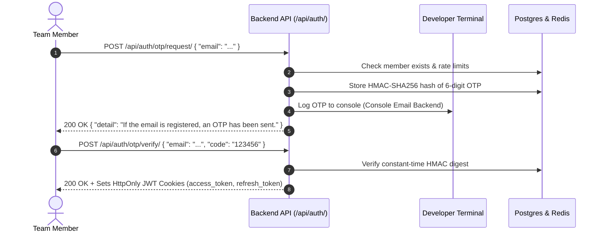

# ENP Racing Team ERP — Backend

Comprehensive Enterprise Resource Planning (ERP) platform and REST API built with **Django REST Framework**, **PostgreSQL (pgvector)**, and **Redis** for the **ENP Racing Team** (Formula Student team at École Nationale Polytechnique, Algiers).

## 📁 Repository layout

| Folder | What it is |
|---|---|
| `backend/` | The ERP's API (Django 6.1 + DRF), see `backend/README.md` |
| `frontend/` | The ERP's web app (Next.js 16, fr/en/ar), see `frontend/README.md` |
| `website/` | The team's public website (Next.js), separate from the ERP |
| `scripts/`, `deploy/` | Start/stop/check/deploy scripts (Windows PowerShell) and the production Caddy + backups |
| `documentation/` | The team's documents; `documentation/erp_validation/` holds the ERP validation dossier (technical PDF, screenshots, decisions D-001…D-025, design notes, known issues, test logs) |
| `documentation/RAPPORT_PROBLEMES_ET_CORRECTIONS.md` | The review of 24/11/2026: every problem found and what was done |

---

## 📌 Important Data Seeding Notice

> [!IMPORTANT]
> **What data is seeded:**
> The database seeder (`seed_all`) populates **ONLY** the organization structure and core people data:
> - **Organizational Units** (`OrgUnit`): Root club, Executive Bureau, Technical Department, FS Subteams, Poles, etc.
> - **Roles** (`Role`): Standardized club and Formula Student roles with scopes and hierarchy.
> - **Members** (`Member`): All active and alumni team members (with university emails, phone numbers, and profile links).
> - **Memberships** (`Membership`): Official team assignments, executive bureau memberships, and primary affiliations.
>
> **What is NOT seeded:**
> All other ERP modules (**Inventory**, **Finance**, **Purchasing**, **Tasks**, **Equipment**, **Documents**, **Telemetry**, **Subsystems**) have their database schemas and Django Admin panels configured, but **contain NO seeded data** (they will appear empty in the admin panel until you add records).

---

## 🛠️ Tech Stack & Requirements

- **Language & Framework:** Python 3.12 to 3.14 (Django 6.1 does not support Python 3.15 yet), Django 6.1, Django REST Framework 3.18
- **Database:** PostgreSQL 16 (pgvector enabled) via Docker
- **Caching & Rate Limiting:** Redis 7 via Docker
- **Authentication:** Invite-Only Passwordless OTP (HMAC-SHA256, Redis cooldown & attempt limits, HTTP-only Cookie JWTs)
- **Email:** Django Console Backend (OTPs output directly to your terminal during development)
- **Containerization:** Docker & Docker Compose

---

## 🚀 Step-by-Step Setup Guide (First-Time User)

Follow these exact steps from scratch to get the project running and access the Django Admin Panel.

### Step 1: Clone the Repository

```bash
git clone <repository-url>
cd enpracingteam
```

---

### Step 2: Configure Environment Variables

The project uses **one** environment file, `.env` at the root of the project: Docker Compose reads it for
the database (`DB_NAME`, `DB_USER`, `DB_PASSWORD`) and Django for all its settings.

#### On Windows (PowerShell):
```powershell
Copy-Item .env.example .env
```

#### On Linux / macOS (Bash):
```bash
cp .env.example .env
```

> [!IMPORTANT]
> **Generate a secret key** and paste it after `SECRET_KEY=` in `.env` (Django refuses to start without a strong one):
> ```bash
> python -c "import secrets; print(secrets.token_urlsafe(64))"
> ```
> Never commit or share this value. Changing it later logs everyone out.

> [!TIP]
> The database and Django read the same lines (`DB_NAME=enp_racing_team_erp`, `DB_USER=enp`, `DB_PASSWORD=changeme`): a password changed in `.env` is changed for both. A `backend/.env` from before is still read, but `manage.py check` asks to move its lines into the root `.env` (warning `members.W001`).

---

### Step 3: Start PostgreSQL & Redis (Docker)

Make sure **Docker Desktop** is running, then run:

```bash
docker compose up -d
```

Verify that both containers (`enp_racing_team_db` and `enp_redis`) are healthy and running:

```bash
docker compose ps
```

---

### Step 4: Set Up Python Virtual Environment & Install Dependencies

Navigate into the `backend/` directory:

```bash
cd backend
```

#### On Windows (PowerShell):
```powershell
# 1. Create virtual environment
python -m venv .venv

# 2. Allow script execution in current PowerShell session (if restricted)
Set-ExecutionPolicy -ExecutionPolicy RemoteSigned -Scope Process

# 3. Activate the virtual environment
.\.venv\Scripts\Activate.ps1

# 4. Install dependencies
python -m pip install --upgrade pip
pip install -r requirements.txt
```

#### On Linux / macOS (Bash):
```bash
# 1. Create virtual environment
python3 -m venv .venv

# 2. Activate the virtual environment
source .venv/bin/activate

# 3. Install dependencies
pip install --upgrade pip
pip install -r requirements.txt
```

---

### Step 5: Run Database Migrations

Apply the database schema to the PostgreSQL database:

```bash
python manage.py migrate
```

---

### Step 6: Seed Initial Data (Members, Roles, Org Units)

Run the master seeding command:

```bash
python manage.py seed_all
```

**What this command does:**
1. Runs `seed_org_units`: Creates the organizational hierarchy.
2. Runs `seed_roles`: Creates all predefined organizational and technical roles.
3. Runs `seed_members`: Creates team members with unusable passwords (invite-only) and sets their primary memberships.
4. Runs `sync_group`: Ensures all department heads are synced to the Executive Bureau.
5. Runs verification checks to confirm data integrity.

> **Reminder:** Only Members, Roles, OrgUnits, and Memberships are populated. Modules like Inventory, Tasks, and Finance remain clean and empty.

---

### Step 7: Create an Admin Account to Access the Admin Panel

Because members are pre-created with unusable passwords (invite-only passwordless system), you need to assign admin privileges and a password to log into the Django Admin web interface.

You have two options:

#### Option A (Recommended): Promote an Existing Seeded Member
Use the built-in `dev_login` command to assign a password and superuser rights to one of the seeded members:

```bash
python manage.py dev_login prenom.nom@g.enp.edu.dz --password admin123 --admin
```
*(You can replace the email with any seeded member's email, e.g., `prenom.nom@g.enp.edu.dz`).*

#### Option B: Create a Brand New Superuser
Alternatively, create a standalone superuser:

```bash
python manage.py createsuperuser
```
Follow the prompts to enter an email and password.

---

### Step 8: Start the Development Server

Start the Django development server:

```bash
python manage.py runserver
```

You will see output similar to:
```text
Django version 6.1.1, using settings 'config.settings'
Starting development server at http://127.0.0.1:8000/
Quit the server with CTRL-BREAK.
```

---

### Step 9: Explore the Django Admin Panel

1. Open your browser and navigate to:
   ```text
   http://127.0.0.1:8000/admin/
   ```
2. Log in using the credentials you configured in **Step 7**:
   - **Email:** `prenom.nom@g.enp.edu.dz` (or your superuser email)
   - **Password:** `admin123` (or your chosen password)
3. **What you will see in the Admin Panel:**
   - **Members App (`apps/members`):**
     - **Members:** Full roster of seeded team members.
     - **Organizational Units:** Departments, poles, and governing bodies.
     - **Roles:** Defined roles across club and FS scopes.
     - **Memberships:** Official role assignments.
     - **Login OTPs:** Audit log of all OTP requests, hashes, and attempts.
   - **Other ERP Apps (Inventory, Tasks, Purchasing, Finance, Equipment, etc.):**
     - Models are visible and ready for usage, but contain **no records** (seeded empty by design).

---

### Step 10: Start the Frontend (Next.js)

With the backend running, in a second terminal (Node.js 20.9 or newer):

```bash
cd frontend
npm install
npm run dev
```

Open **http://localhost:3000** (not 127.0.0.1: the login cookies of the API are shared through the
host name `localhost`). Log in with a member's e-mail: locally, the code is printed in the Django
server console. Details, scripts and conventions: [`frontend/README.md`](frontend/README.md).

---

### Start Everything in One Command (this PC)

Once the steps above have been done, `scripts\start_erp.ps1` starts the whole ERP for daily use or a
presentation: Docker Desktop and the containers, the migrations, the production build of the web pages
(only when the frontend changed since the last one), the API and the pages in two windows ("ERP - API",
"ERP - Web"), then the browser at **http://localhost:3000**. Only this PC can open it.
`scripts\stop_erp.ps1` stops it again.

```powershell
powershell -NoProfile -ExecutionPolicy Bypass -File scripts\start_erp.ps1         # start
powershell -NoProfile -ExecutionPolicy Bypass -File scripts\start_erp.ps1 -Demo   # demo data reset first
powershell -NoProfile -ExecutionPolicy Bypass -File scripts\stop_erp.ps1          # stop (-Docker: containers too)
```

`scripts\start_erp.cmd` and `scripts\stop_erp.cmd` do the same with a double-click. The sign-in codes
and the e-mails are printed in the "ERP - API" window: on this PC no e-mail is sent. The API runs with
the settings of the root `.env` and Django's own server: putting the ERP on a server for the whole team
needs a production setup (HTTPS, real e-mails, backups), not this script: see the next section.

---

### Production on This PC, on the Internet (Docker + Caddy)

`docker-compose.prod.yml` runs the ERP for the whole team: PostgreSQL, Redis, the API under gunicorn, the
Next.js production build, a scheduler (`manage.py run_scheduler`: the deadline reminders at 07:00, Algiers
time) and a nightly database backup (03:00, the last 14 days kept). It is separate from development (its
own project, database, secrets and ports) and listens on `127.0.0.1` only: Caddy, installed on Windows,
is the only way in, in HTTPS (Let's Encrypt), on one address. Caddy runs outside Docker because Docker
Desktop hides the visitors' addresses, which the sign-in limits need. Django's admin and the API docs
answer from the local network only.

```powershell
powershell -NoProfile -ExecutionPolicy Bypass -File scripts\deploy_prod.ps1 -Trial   # everything on this PC, https://erp.localhost
powershell -NoProfile -ExecutionPolicy Bypass -File scripts\deploy_prod.ps1          # production (backend\.env.prod)
powershell -NoProfile -ExecutionPolicy Bypass -File scripts\backup_prod.ps1          # a backup now (-Restore <file> to restore)
```

The settings are in `backend\.env.prod` (made from `backend\.env.prod.example` with new secrets;
never committed): the address, the e-mail for Let's Encrypt and the club's Gmail (an app password).
With `DEBUG=False`, Django runs behind the proxy in HTTPS only (secure cookies, HSTS, SSL redirect);
`manage.py check --deploy` passes (tested). Data: `C:\ERP` (static files, backups, logs, certificates).

---

## 🔐 Authentication & API Usage Overview

The API implements a production-grade **Passwordless Email OTP Authentication** flow:



### Key API Endpoints:
- `POST /api/auth/otp/request/`: Request an OTP for a registered email.
- `POST /api/auth/otp/verify/`: Submit the 6-digit code; returns user info and sets HTTP-only JWT cookies.
- `POST /api/auth/refresh/`: Refresh JWT session using the refresh cookie.
- `POST /api/auth/logout/`: Clear auth cookies and invalidate session.
- `GET /api/auth/me/`: Retrieve the authenticated user's profile and memberships.
- `GET /api/members/`: List members (phone and Facebook are only shown to the member, club admins and heads of their units).
- `GET /api/members/<id>/`: One member with their memberships.
- `GET /api/org-units/`: The organisation tree (team, departments, cells…).
- `GET /api/executive-bureau/`: Current members of the Executive Bureau.
- `GET /api/projects/`: Projects with their task counts (filters `status`, `category`, `mine=true`); `POST /api/projects/`: create one (club admins).
- `GET /api/projects/<id>/`: One project with its current team; `PATCH /api/projects/<id>/`: change it (admins and its manager).
- `GET /api/lifecycle-steps/`: The 7 engineering steps (study, CAD, simulation, head's validation…).
- `GET /api/subsystems/`: Subsystems with their lifecycle progress (filters `project`, `org_unit`); `PATCH /api/subsystems/<id>/`: change the status.
- `PATCH /api/subsystems/<id>/steps/<step_id>/`: Tick or untick a lifecycle step (the head's validation step: a leader of the unit only).
- `GET /api/tasks/`: Tasks, most urgent first (filters `project`, `subsystem`, `status`, `priority`, `assignee=me`, `parent=none`, `search`, `overdue`); `POST /api/tasks/`: create one.
- `GET /api/tasks/<id>/`: One task with subtasks, comments and the viewer's rights; `PATCH /api/tasks/<id>/`: change it (assignees: the status only); `DELETE /api/tasks/<id>/`.
- `POST /api/tasks/<id>/comments/`: Comment on a task; `DELETE /api/tasks/<id>/comments/<comment_id>/`: delete a comment (its author or an admin).
- `GET /api/notifications/`: My notifications, newest first (`unread=true` for the unread ones only).
- `GET /api/notifications/unread-count/`: How many of my notifications are unread (the bell's number).
- `POST /api/notifications/<id>/read/`: Mark one of them as read; `POST /api/notifications/read-all/`: mark them all.
- `GET /api/purchasing/requests/`: Purchase requests, open and most urgent first (filters `status`, `open`, `mine`, `to_approve`, `unit`, `project`, `subsystem`, `search`); `POST /api/purchasing/requests/`: ask for a part (a known one or a new one).
- `GET /api/purchasing/requests/summary/`: How many requests at each step, how many await my approval, mine still open.
- `GET /api/purchasing/requests/<id>/`: One request with its order, its history and the viewer's rights; `PATCH /api/purchasing/requests/<id>/`: change it while it awaits its leader.
- `POST /api/purchasing/requests/<id>/approve/`: Approve the step it awaits (its leader, then the head of Operations); `POST /api/purchasing/requests/<id>/refuse/` and `POST /api/purchasing/requests/<id>/cancel/`: with a reason.
- `POST /api/purchasing/requests/<id>/order/`: Place the order (Operations; currency and rate paid, total in dinars); `PATCH /api/purchasing/requests/<id>/order/`: change it; `POST /api/purchasing/requests/<id>/cancel-order/`: the request is to order again.
- `POST /api/purchasing/requests/<id>/receive/`: The parts arrived: the order is delivered and they enter the stock.
- `GET /api/purchasing/suppliers/`: Suppliers (their contacts: Operations, club admins and unit leaders only); `POST /api/purchasing/suppliers/` and `PATCH /api/purchasing/suppliers/<id>/`: Operations.
- `GET /api/purchasing/parts/`: Parts already known (`search`); `GET /api/purchasing/parts/<id>/`: one of them; `GET /api/purchasing/shipping-addresses/`: Operations only.
- `GET /api/inventory/items/`: Stock lines, the low ones first (filters `search`, `low`, `category`, `part`); `POST /api/inventory/items/`: a new line with the stock already there (stock managers).
- `GET /api/inventory/items/summary/`: How many lines, how many at their threshold or below, and whether the viewer manages the stock.
- `GET /api/inventory/items/<id>/`: A line with its latest movements; `PATCH /api/inventory/items/<id>/`: its place and threshold (stock managers).
- `POST /api/inventory/items/<id>/take/`: Take parts out, for a task, handed to a member; `POST /api/inventory/items/<id>/add/`: a manual entry, with where it comes from; `POST /api/inventory/items/<id>/count/`: a count, the difference becomes an adjustment (stock managers).
- `GET /api/inventory/movements/`: The stock journal, the latest first (filters `item`, `task`, `type`, `mine`).
- `GET /api/health/`: System health check endpoint.

Who may do what on projects, subsystems and tasks is written in one place,
`backend/apps/projects/access.py` (every member sees everything; the rights to change things depend
on the role: club admin, project manager, unit leader, assignee, author).

Who is notified of what (a task assigned, a comment, a task blocked or done, a validation awaited
or signed, a due date in 3 days or past, a purchase to approve, to order or moving on) is written in
`backend/apps/communication/notify.py`; assignments, awaited validations, due dates and purchases to
approve or to order are e-mailed too, in each person's language.

Purchases (decided on 19/10/2026): a request is approved by its leader (a leader of its unit or the
project manager), then by the head of Operations & Partnerships, before Operations order it; each
step is kept in its history, and the parts enter the stock when they are received. The rights are
in `backend/apps/purchasing/access.py`, the steps in `backend/apps/purchasing/workflow.py`.

Stock (decided on 19/10/2026): every member sees the stock; the stock managers — Operations (the head of Operations & Partnerships and its logistics coordinators), the Manufacturing & Workshop Lead and the club admins — record the entries, the exits (like a storekeeper: members ask, a manager records) and the counts. Every change of a quantity goes through `backend/apps/inventory/movements.py`, so the quantity always equals the sum of the movements; the parts of a received order enter the stock there too. When a line reaches its threshold, the stock managers are told (ERP and e-mail). The rights are in `backend/apps/inventory/access.py`.
- `GET /api/docs/`: Interactive API documentation (Swagger), staff only: log into `/admin/` first. The raw OpenAPI schema is at `/api/schema/`.

> These paths are checked by the test `ReadmeEndpointsTests`: if you rename a route, update this list.

---

## 📋 Useful Management Commands

| Command | Description |
|---|---|
| `python manage.py seed_all` | Runs `seed_org_units`, `seed_roles`, `seed_members`, `sync_group` in sequence with verification. Safe to run multiple times. |
| `python manage.py dev_login <email> --password <pwd> [--admin]` | Sets a password and optional admin privileges (`is_staff`, `is_superuser`) for a member during development. |
| `python manage.py send_deadline_reminders` | Tells the people linked to each unfinished task (assigned, author, project manager), in the ERP and by e-mail, 3 days before its due date and once it is past. Once per due date: schedule it once a day. |
| `python manage.py import_subcontracting_sheet "<file.xlsx>" [--dry-run]` | Imports the team's subcontracting workbook (suppliers, shipping addresses, parts, purchase requests and their orders) into the purchasing module. Prints counts only; safe to run again; `--dry-run` saves nothing. What the sheet leaves incomplete is guessed and marked "à vérifier". The workbook holds outside people's contacts: keep it out of Git. |
| `python manage.py check` | Runs Django system sanity checks. |
| `python manage.py makemigrations --check` | Verifies there are no unapplied model schema changes or migration drift. |

---

## ❓ Troubleshooting & FAQs

### 1. Database Connection Error (`connection to server at "localhost" failed`)
- Ensure Docker Desktop is running.
- Run `docker compose ps` to confirm the PostgreSQL container is up.
- Verify `DB_PORT=5432`, `DB_USER=enp` and `DB_PASSWORD` in the root `.env` (Docker Compose and Django read the same lines).

### 2. Redis Connection Error (`Error connecting to Redis on localhost:6379`)
- Ensure the Redis container is running via `docker compose ps`.
- Check `REDIS_URL=redis://localhost:6379/0` in `.env`.

### 3. PowerShell Script Execution Policy Restriction
If `.\.venv\Scripts\Activate.ps1` produces an execution policy error, run:
```powershell
Set-ExecutionPolicy -ExecutionPolicy RemoteSigned -Scope Process
```
and then run `.\.venv\Scripts\Activate.ps1` again.

### 4. Port 5432 or 6379 Already in Use
If another local service (e.g., local PostgreSQL service or Redis) is using port 5432 or 6379:
- Stop the local service, or:
- Modify the host port in `docker-compose.yml` (e.g., `"5433:5432"`) and update `DB_PORT=5433` in `.env`.
